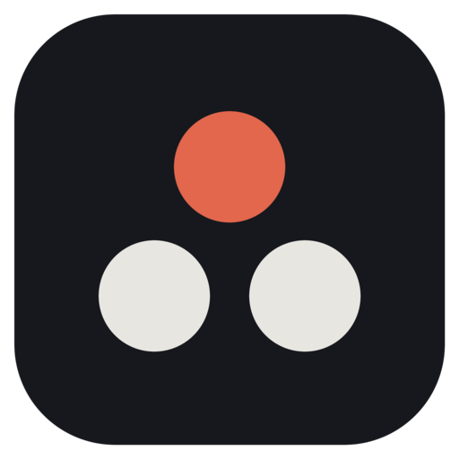

<p align="center"></p>

<h1 align="center">crew</h1>

<p align="center"><strong>Your own Claude Code agents, working on their own.</strong></p>

Brief an agent once, in plain words. It writes its own job description, does the work, keeps its own folder,
and checks in only when something is yours to decide. You keep it all in a terminal workspace next to your editor.

```bash
npm install -g @sandydasari/crew
crew
```

Needs macOS, [Claude Code](https://claude.com/claude-code) (signed in), `tmux`, Python 3.10+, and `gh` for GitHub
work. For clickable notifications: `brew install terminal-notifier`.

## The workspace

`crew` opens a tmux workspace. On the left, your agents and what each one is doing; on the right, the one you picked.

- **Feed**: each agent's conversation. Its wake reports, your messages and its replies, what you answered, and
  the questions waiting on you: press `1`–`n` to answer, `ctrl+n` for the next one, `ctrl+x` to dismiss, `ctrl+l` to clear the feed, `ctrl+o` to see each step it took (a running wake shows them live). Select text to copy it. Type to
  message it. Enter on an empty line opens the full Claude Code chat with it.
- **Activity**: what every agent did, newest first, with anything that needs you on top.
- **Threads**: split a topic off into its own chat (“take this into a separate chat”).
- **Notifications**: when an agent needs you, is paused, or keeps failing. Click one to open that agent.
- **Morning brief** (`crew brief`) and **learn** (`crew learn <agent>`: it studies how you review and reply on
  GitHub, so its drafts sound like you).

Keys in the rail: `enter` open · `r` wake now · `s` start/stop · `n` new agent · `e` edit its job · `d` answer.

## How an agent works

It is a folder, `~/.crew/agents/<name>/`:

- `AGENT.md`: its job, rules and how you like things. Written from your brief on its first wake, kept current by it.
- `INDEX.md`: its own map of the folder. `notes/`, `work/` (its git worktrees) and `.claude/skills/` are its own.
- `agent.json`: your settings for it: budget, tools, folders, notifications, and the freedoms you've given it.

**It does the work.** Each wake it decides what deserves attention and does it: investigates, writes and tests
code in its own worktrees, commits locally. It asks you first before anything public or done as you (pushing,
posting, reviewing, messaging, changing tickets), destroying things outside its folder, or spending money. Those
tools are blocked in its wakes, and folders you list under `protect` are read-only to it, enforced by the macOS
sandbox.

**It manages its own time.** After each wake it picks when to wake next, from a minute to three days. A *watch*
is a cheap shell command crew runs without the model; every line it prints wakes the agent.

**It splits big work** across helpers running in parallel, each in its own worktree, and checks what comes back.

**Trust grows.** Answer the same kind of question the same way a few times and it offers a standing rule. Say yes
and it handles those itself from then on. Merging, closing and force-pushing can never be handed over.

**It stays within a budget**, $100 a day per agent unless you set another. On a Claude plan, when you hit the usage
limit, agents pause until the exact reset time.

## Commands

```
crew                         the workspace
crew new <name> "brief"      create an agent; it starts right away
crew feed <name>             one agent's conversation
crew ask <name> "…"          message an agent and print its reply
crew chat <name>             the full Claude Code chat with it
crew run <name> [--note …]   wake it now
crew decide                  walk through everything waiting on you
crew inbox · crew runs · crew status · crew brief · crew learn <name>
```

## Settings

`~/.crew/config.json`:

```json
{
  "daily_budget_usd": 100,
  "wake_timeout_minutes": 90,
  "protect": ["~/code/main-checkout"],
  "terminal_app": null
}
```

Per agent, in its `agent.json`: `budget_usd`, `model`, `folders`, `protect`, `notify`, `tools`.

## Status

Early. It drives Claude Code and runs with your user's access, so treat an agent like a colleague with access to
your laptop, and protect what must never change.

MIT licence.
